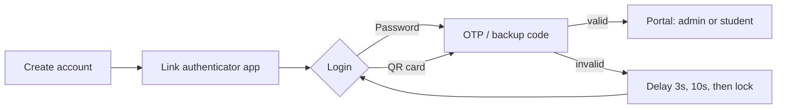

# 🔐 Secure Two-Factor Login System | نظام الدخول الآمن بخطوتين

A single-file web application that demonstrates **two-factor authentication (2FA)**, **brute-force protection**, and **role-based access** through a student grades portal. It runs entirely in the browser: no server, no installation.

**English summary:** Password (SHA-256 + salt) → TOTP code (RFC 6238, Google Authenticator compatible) or backup code → protected portal. Includes account lockout with progressive delay, a security log, admin/student roles, QR-card login, and an Arabic RTL mobile-friendly UI.

> ⚠️ **This is an educational prototype.** All data and checks live in the browser, so it must not be used to protect real data. See [Limitations](#القيود-limitations).

---

<div dir="rtl">

## 📌 نبذة عن المشروع

برنامج لتسجيل الدخول يحمي **الحساب** (وليس الجهاز). لا يكفي معرفة كلمة المرور للدخول، بل يتطلب النظام خطوة تحقق ثانية برمز يتغير كل 30 ثانية. بعد الدخول تظهر **بوابة درجات الطلاب** كمثال على نظام محمي.

مشروع مقدّم لمادة **هندسة البرمجيات**، وهو ملف واحد `index.html` بدون أي تثبيت.

## ✨ الميزات

| المجال | الميزة |
|---|---|
| **المصادقة** | كلمة مرور مخزنة كبصمة `SHA-256` مع Salt عشوائي |
| | رمز OTP من 6 أرقام يتغير كل 30 ثانية (TOTP) متوافق مع Google Authenticator |
| | 8 رموز احتياطية تُستعمل مرة واحدة لكل رمز |
| | الدخول ببطاقة باركود (QR) شخصية بالكاميرا أو بالصق قيمتها |
| **الحماية** | قفل الحساب بعد 3 محاولات فاشلة بمدة قابلة للضبط، مع فتح تلقائي |
| | تأخير متزايد: 3 ثوانٍ ثم 10 ثوانٍ قبل القفل |
| | سجل أمني، مخطط للمحاولات، تنبيه «نشاط مشبوه»، وتصدير إلى CSV |
| | مقياس قوة كلمة المرور ورفض الكلمات الشائعة |
| **الصلاحيات** | **مدير:** يرى كل الطلاب، يضيفهم، يعدّل مواد ودرجات كل طالب، ويدير الحسابات |
| | **طالب:** يرى درجاته فقط للاطلاع |
| **الحساب** | تغيير كلمة المرور، تلميح، آخر تسجيل دخول، تحذير من محاولات فاشلة سابقة |
| **الواجهة** | عربية (RTL)، متجاوبة مع الجوال، وصفحة «عن المشروع» لمفاهيم هندسة البرمجيات |

## 🚀 التشغيل

1. حمّل الملف `index.html` (أو انسخ المستودع).
2. افتحه بنقر مزدوج بمتصفح حديث (Chrome أو Edge أو Firefox).
3. افتحه أول مرة وأنت **متصل بالإنترنت**، لتحميل مكتبتي رمز QR والكاميرا.

بدون إنترنت يعمل البرنامج كاملاً، ما عدا رسم رمز QR وقراءته بالكاميرا (يوجد المفتاح اليدوي بدلاً منه).

**التجربة على الإنترنت (GitHub Pages):**
`Settings` ← `Pages` ← `Deploy from a branch` ← الفرع `main` والمجلد `/ (root)`. ثم يظهر رابط `https://USERNAME.github.io/REPO/`.

## 🧭 طريقة الاستخدام

1. **أول حساب** تنشئه يصير **مدير** تلقائياً.
2. امسح رمز QR بتطبيق **Google Authenticator** (أو استعمل المفتاح اليدوي، أو صندوق «المحاكاة» للعرض بدون جوال).
3. سجّل الدخول: كلمة المرور، ثم رمز التحقق.
4. **المدير:** من «قائمة الطلاب» اضغط **+ إضافة طالب** (اسمه هو اسم دخوله)، ثم اضغط اسمه لفتح ملفه وإضافة المواد والدرجات وتسليمه بيانات التحقق.
5. **الطالب:** يدخل باسمه وكلمة مروره فيرى درجاته.
6. سهم **→ رجوع** يرجع خطوة خطوة، وعند الوصول لقائمة الطلاب يسأل قبل تسجيل الخروج.

## 🔄 مخطط الدخول



## 🧱 التقنيات

| التقنية | الاستخدام |
|---|---|
| HTML, CSS, JavaScript (بدون أطر عمل) | الواجهة والمنطق |
| Web Crypto API | `SHA-256`، `HMAC-SHA1`، أرقام عشوائية آمنة |
| `localStorage` | حفظ الحسابات والسجل داخل المتصفح |
| [qrcode-generator](https://cdnjs.com/libraries/qrcode-generator) 1.4.4 | رسم رمز QR |
| [jsQR](https://cdnjs.com/libraries/jsQR) 1.4.0 | قراءة رمز QR من الكاميرا |

## 🗂️ هيكل البيانات

كل مستخدم سجل داخل المفتاح `sa_db` في `localStorage`:

```js
{
  salt, hash,                    // كلمة المرور كبصمة
  secret,                        // مفتاح TOTP (Base32)
  tk,                            // بصمة رمز بطاقة الباركود
  bc: [ ... ],                   // بصمات الرموز الاحتياطية
  fails, locked, until, wait,    // القفل والتأخير
  role,                          // 'admin' | 'student'
  name, grades: [['المادة','الدرجة']],
  lastOk, lastFail, failsSince, hint
}
```

## 📋 المتطلبات (Requirements)

**متطلبات المستخدم:**

| الرمز | المتطلب |
|---|---|
| UR1 | يدخل الطالب باسمه وكلمة مروره فيرى درجاته. |
| UR2 | لا يرى الطالب ولا يعدّل درجات غيره. |
| UR3 | يضيف المدير طلاباً ويعدّل موادهم ودرجاتهم أو يحذفها. |
| UR4 | يطلب النظام خطوة تحقق ثانية بعد كلمة المرور. |
| UR5 | يُقفل الحساب بعد محاولات فاشلة متكررة. |

**متطلبات النظام:**

| الرمز | المتطلب | يحقق |
|---|---|---|
| SR1 | تُخزَّن كلمة المرور كبصمة `SHA-256` مع Salt عشوائي. | UR1 |
| SR2 | رمز OTP من 6 أرقام كل 30 ثانية (RFC 6238) ويُقبل بفارق ±30 ثانية. | UR4 |
| SR3 | بعد 3 محاولات فاشلة يُقفل الحساب مدة قابلة للضبط (الافتراضي 5 دقائق)، مع تأخير 3 ثم 10 ثوانٍ. | UR5 |
| SR4 | تُفحص الصلاحية (مدير/طالب) داخل كل عملية. | UR2, UR3 |
| SR5 | تُسجَّل كل محاولة دخول بالسجل الأمني مع وقتها. | UR5 |

## 🛠️ عملية التطوير

استُخدم نموذج **Incremental development**: أُضيفت الميزات على دفعات، وجُرّبت كل دفعة قبل التي بعدها. وهي من نوع **Web/mobile application**. شرح الخطوات كاملاً في [`docs/project-explanation.html`](docs/project-explanation.html).

## ⚠️ القيود (Limitations)

- **لا يوجد سيرفر ولا قاعدة بيانات.** الحسابات والدرجات تنحفظ داخل متصفح الجهاز الذي أُنشئت عليه، فلا تظهر على جهاز آخر أو متصفح آخر.
- **التحقق يجري في المتصفح**، فمن يفتح أدوات المطوّر على الجهاز يستطيع تغيير البيانات. لذلك لا يصلح لحماية بيانات حقيقية.
- مفتاح TOTP مخزّن بشكل قابل للقراءة داخل المتصفح (ضروري لتوليد الرمز في النموذج).
- `SHA-256` سريعة؛ الأنظمة الحقيقية تستعمل `bcrypt` أو `Argon2`.
- لا يُنصح بإدخال كلمات مرور حقيقية لك أثناء التجربة.
- الاختبار الآلي جرى على محرك Chromium (أندرويد وويندوز بـ Chrome وEdge). لم يُختبر على Safari أو Firefox.

## 🔭 التطوير المستقبلي

- [ ] سيرفر Python (Flask) وقاعدة بيانات SQLite ونقل التحقق والصلاحيات إليه
- [ ] تخزين كلمات المرور بـ `bcrypt` أو `Argon2`
- [ ] إرسال OTP بالإيميل أو SMS كخيار إضافي
- [ ] HTTPS وتحويله إلى تطبيق PWA يُثبَّت على الجوال
- [ ] إلزام الطالب بتغيير كلمة المرور عند أول دخول
- [ ] تصدير واستيراد البيانات بين الأجهزة

## 📁 هيكل المستودع

```
.
├── index.html                    # البرنامج كاملاً
├── README.md                     # هذا الملف
└── docs/
    ├── project-explanation.html  # شرح مراحل البناء بالتفصيل
    └── screenshots/              # لقطات الشاشة (أضفها بنفسك)
```

## 👤 المطوّر

- **الاسم:** ........
- **المادة:** هندسة البرمجيات
- **إشراف:** د. ........

## 📄 الترخيص

أضف ملف `LICENSE` يناسبك (مثلاً MIT). المشروع تعليمي.

</div>
